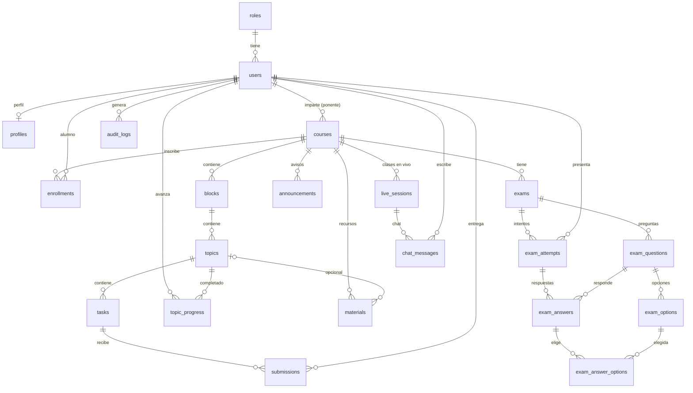

# Base de datos — Cursos el Mai

Fuente de verdad: `database/schema.sql` (22 tablas + 1 vista). Se crea a mano desde la consola de MySQL;
**la app no ejecuta migraciones**. Cambios futuros: archivos numerados en `database/changes/` (`001_*.sql`...),
aplicados a mano y reflejados también en `schema.sql`.

Probado en MariaDB 10.11 (carga limpia, re-ejecutable, restricciones y cascadas verificadas con datos de prueba)
y en **MySQL 8.0.46**, el servidor local real, donde viven `cursos_el_mai` y `cursos_el_mai_test` (esquemas idénticos, comparados
con `information_schema` el 2026-10-22). Usa solo sintaxis común a ambos; si algo falla al cargarlo, avisa.

## Crear la base (tú, en tu consola)

```bash
# 1. Antes de ejecutar: abre 00_database_and_user.sql y cambia CAMBIA_ESTA_CLAVE por una clave larga.
mysql -u root -p < database/00_database_and_user.sql
mysql -u root -p cursos_el_mai      < database/schema.sql
mysql -u root -p cursos_el_mai_test < database/schema.sql   # base para pruebas automáticas
```

La app se conecta como `cursos_app` (solo SELECT/INSERT/UPDATE/DELETE), nunca como root. La clave va solo en `.env`.

## Diagrama



## Mapa rápido

| Grupo | Tablas | Notas |
|---|---|---|
| Acceso | `roles`, `users`, `profiles`, `password_reset_tokens` | 1 rol por usuario. `users` con borrado lógico. |
| Contenido | `courses` > `blocks` > `topics` > `tasks`, `materials` | Cursos con borrado lógico; lo demás en cascada. |
| Inscripción | `enrollments` | "Eliminar alumno" = `status='removed'` (conserva su historial). |
| Misiones | `topic_progress` | Una fila = tema completado. De aquí salen los desbloqueos. |
| Calificaciones | `submissions`, `exam_attempts`/`exam_answers`, vista `v_gradebook` | El alumno solo lee la vista. No hay tabla `grades` aparte. |
| Exámenes | `exams`, `exam_questions`, `exam_options`, `exam_attempts`, `exam_answers`, `exam_answer_options` | Opción múltiple y verdadero/falso se califican solos; abiertas, a mano. |
| Comunicación | `announcements`, `live_sessions`, `chat_messages` | `chat_mode`: `off` / `open` / `moderated`. |
| Monitoreo | `audit_logs`, `users.last_login_at` | Para director y super admin. |

## Reglas que el SQL no puede imponer (las cumple la app)

- `courses.ponente_id` debe ser un usuario con rol `ponente`; `enrollments.user_id`, un `alumno`.
- Solo un alumno **inscrito y activo** puede entregar tareas, presentar exámenes o escribir en el chat.
- Las preguntas de un examen no se editan una vez que existe algún intento (borrarlas borraría respuestas en cascada).
- `topic_progress` la crea la app cuando se cumplen las reglas del tema (ver `docs/PLAN.md`, "Reglas de misiones").
- Consultas sobre `users`, `courses` y `announcements` filtran `deleted_at IS NULL` (Eloquent `SoftDeletes`).
- Fechas en UTC; la app las muestra en `America/Mexico_City`.
- Archivos en almacenamiento **privado**; la BD solo guarda la ruta (nombre aleatorio) y el nombre original.

## Consultas clave (ambas probadas con datos de ejemplo)

Estado de bloqueo de cada bloque para un alumno (modo `sequential`): un bloque está abierto si es el primero
o si todos los temas obligatorios de los bloques anteriores ya están completados.

```sql
SELECT b.id, b.title,
  (b.id = (SELECT id FROM blocks WHERE course_id = b.course_id ORDER BY position, id LIMIT 1)
   OR NOT EXISTS (
     SELECT 1 FROM blocks pb
     JOIN topics t ON t.block_id = pb.id AND t.is_required = 1
     LEFT JOIN topic_progress tp ON tp.topic_id = t.id AND tp.user_id = :user
     WHERE pb.course_id = b.course_id
       AND (pb.position, pb.id) < (b.position, b.id)
       AND tp.topic_id IS NULL)) AS unlocked
FROM blocks b
WHERE b.course_id = :course
ORDER BY b.position, b.id;
```

Promedio ponderado de un alumno en un curso (0–100):

```sql
SELECT user_id, ROUND(SUM(score / max_score * weight) / SUM(weight) * 100, 2) AS promedio
FROM v_gradebook
WHERE course_id = :course AND user_id = :user
GROUP BY user_id;
```

El resto de consultas (pendientes por calificar, tablero del director...) se escriben con Eloquent en la app.
